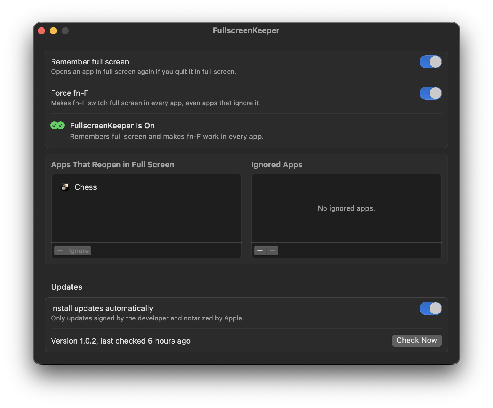

# FullscreenKeeper

**Quit an app in full screen, and it opens in full screen next time.**

<p align="center">
  
</p>

You quit an app with Command-Q while it's in full screen, open it again, and it comes back as a window. macOS only
restores full screen for apps that save their window state, and only while "Close windows when quitting an
application" is off in Desktop & Dock. Many apps don't, so you click the green button again every time.
FullscreenKeeper remembers which apps you quit in full screen and puts them back in full screen when they open. If
you leave full screen before quitting, the app opens as a window next time, the way you left it.

## What it does

- If you quit an app while one of its windows is in native full screen, FullscreenKeeper remembers it and puts the
  window back into full screen when the app opens again.
- When you leave full screen and then quit, the app is forgotten and opens normally.
- Apps that restore full screen on their own are left alone.
- The window lists the apps that will reopen in full screen. Select one and click the minus button to forget it.
- Apps you never want touched go in the Ignored Apps list. Use the plus button, or select an app in the top list
  and click **Ignore**. FullscreenKeeper never reads or changes their windows.
- Updates itself from GitHub releases (see [Updates](#updates)).

## Resource use

The agent uses about 3.4 MB of memory. It has no timers and doesn't poll; it only wakes when WindowServer reports
that a full-screen Space was created or closed, or when an app opens. Switching between desktops, full-screen apps
or windows doesn't wake it. Over two minutes idle it used 0.4 ms of CPU and had no wakeups. Entering or leaving
full screen costs about 0.7 ms of CPU.

Measured on macOS 26.7.1: memory with `footprint`, CPU and wakeups with the kernel's `proc_pid_rusage` counters.

The update check is a separate process that runs once a day and after a restart, for about 0.3 seconds, and then
exits. There is no menu bar icon, and the settings window only runs while it's open. The app is about 640 KB.

## Accessibility permission

FullscreenKeeper needs Accessibility access to see whether a window is in full screen and to put it back. Click
**Open Accessibility Settings...** in the window and allow **FullscreenKeeper** (it may show up as
**fullscreenkeeperd**). Without it the agent does nothing.

It only checks and sets the full-screen state of an app's windows; it doesn't read window titles, contents or
keystrokes. All it stores is the name and bundle ID of each app in its two lists.

## Updates

Once a day, and after a restart, FullscreenKeeper asks GitHub for the latest release and installs it if it's
newer. An update is only installed when it's signed with the same Developer ID and notarized by Apple. The disk
image is checked before it's opened, and the app inside is checked again before it replaces the old one. The check
also runs at the first login after a macOS update, in case a fix for that version is already out.

The check is one request to `api.github.com` that sends only the app name and version. macOS asks once whether
FullscreenKeeper may show a notification after an update; you can change that later in **System Settings >
Notifications**. Turn off **Install updates automatically** to get a notification instead and install from the
window. Homebrew installs update themselves too. The cask is marked as auto-updating, so `brew upgrade` skips it
unless you add `--greedy`.

## Good to know

- The app has to support native full screen (the green button). Games and apps with their own full-screen mode may
  not work.
- Only full screen comes back, not window size, position or which display the window was on.
- Split View: each app comes back in its own full screen, not side by side.
- If an app takes more than about 15 seconds to show its window, FullscreenKeeper gives up for that launch and
  tries again next time.

## Requirements

- A Mac with Apple silicon
- macOS 13 Ventura or later

Tested on a 14-inch MacBook Pro (Apple silicon) with macOS 26.7.1 Tahoe.

## Install

### Homebrew

```sh
brew install --cask fratayaydn/tap/fullscreenkeeper
```

### Download

Download `FullscreenKeeper-<version>.dmg` from the
[latest release](https://github.com/fratayaydn/fullscreenkeeper/releases/latest), open it and drag
**FullscreenKeeper** to **Applications**. The app is signed with a Developer ID and notarized by Apple.

### First run

Open **FullscreenKeeper**, give it Accessibility access with the button in the window, and turn on **Enable
FullscreenKeeper**. Close the window when you're done and FullscreenKeeper keeps working in the background.

## How it works

- `FullscreenKeeper.app/Contents/MacOS/fullscreenkeeperd` is a small background agent, registered as a login item
  through `SMAppService`. It asks WindowServer to report when a full-screen Space is created or closed, and
  otherwise sleeps.
- When a full-screen Space appears, it saves the app in front. When one closes and the app is still running as a
  window, you left full screen, so the app is forgotten. If the app quit instead, it stays remembered.
- When a remembered app opens, it waits for its window and sets full screen through Accessibility. It never brings
  an app to the front.
- Only the agent touches other apps' windows. The window only saves settings, so the two never race.
- It watches its app bundle through the kernel's event queue: when the app is replaced by an update it restarts
  with the new version, and when the app is moved to the Trash it removes its login items and quits.
- `FullscreenKeeper.app/Contents/MacOS/FullscreenKeeper` is the SwiftUI settings window. It runs only while open.

To see full-screen Spaces come and go, the agent uses WindowServer notifications that Apple doesn't document. If a
macOS update removes them, it falls back to the public AppKit notification, which works too but wakes it on every
Space switch. Everything else uses public macOS APIs.

## Building from source

Requires the Xcode Command Line Tools (`xcode-select --install`).

```sh
git clone https://github.com/fratayaydn/fullscreenkeeper.git
cd fullscreenkeeper
make install
```

This builds `FullscreenKeeper.app`, copies it to `/Applications` and opens it. To update, pull and run
`make install` again. `make test` runs the tests.

Local builds are signed with a self-signed certificate that `scripts/create-signing-identity.sh` creates on the
first build, so the login item keeps working across rebuilds; `scripts/install.sh` re-registers it after each
update. To sign with your own Apple Developer ID instead:
`make install SIGN_IDENTITY="Developer ID Application: Your Name (TEAMID)"`.

## Uninstall

Move **FullscreenKeeper** from Applications to the Trash (or `brew uninstall --cask fullscreenkeeper`). The
background agent notices, removes its login items and quits. Your settings are kept in case you install it again.

To remove the settings too, use `brew uninstall --zap --cask fullscreenkeeper` instead, or run
`defaults delete io.github.fratayaydn.fullscreenkeeper` after moving the app to the Trash. If you built it from
source, `make uninstall` in the cloned folder removes both the app and the settings.

## Command line

```sh
/Applications/FullscreenKeeper.app/Contents/MacOS/fullscreenkeeperd --status   # prints the remembered apps
```

## More small Mac apps

- [NightKeys](https://github.com/fratayaydn/nightkeys): keyboard backlight that only comes on when you type on the
  built-in keyboard
- [BalanceKeeper](https://github.com/fratayaydn/balancekeeper): puts the left/right audio balance back when macOS
  shifts it
- [CapsNow](https://github.com/fratayaydn/capsnow): turns off the Caps Lock delay, so quick taps register
- [MicKeeper](https://github.com/fratayaydn/mickeeper): keeps AirPods and iPhones off the microphone, so AirPods don't
  drop to call quality

## License

MIT license, see [LICENSE](LICENSE).
